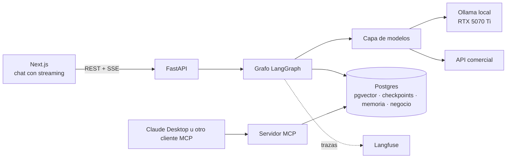
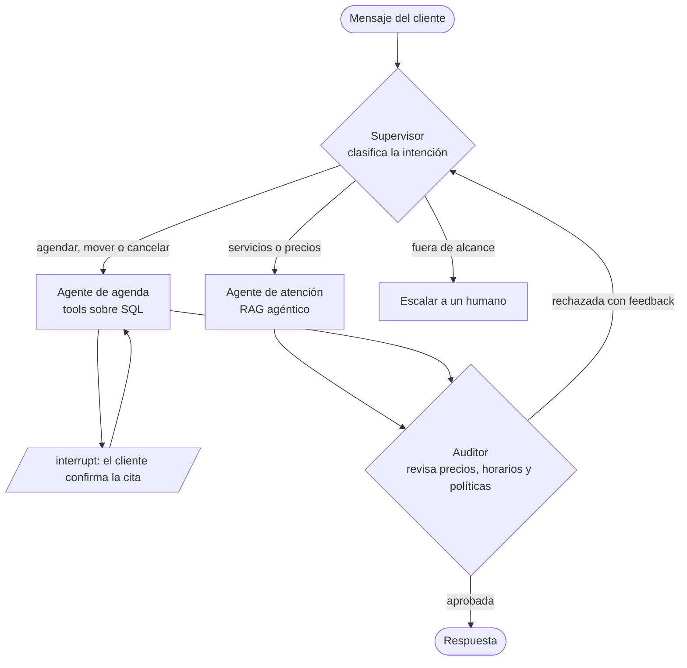

# Proyecto 01 · Agente avanzado con LangGraph

Propuesta de aprendizaje construida a partir de tus notas del vault CEREBRO DIGITAL.

> **Estado al 2026-11-21**: dominio elegido, la opción A. El stack definitivo está en [ADR 0001](docs/adr/0001-stack-tecnologico.md) y sustituye a la tabla de stack de este documento. La observabilidad y el versionado están en [ADR 0002](docs/adr/0002-observabilidad-y-versionado.md).

## Qué tomé de tus notas

- **PROYECTOS IA ENGGINER**: las cinco piezas que piden las empresas, que son MCP, RAG, memoria, evals y harness, y la idea de que no sean cinco proyectos sueltos sino una sola aplicación que va creciendo.
- **Ideas IA agninner**: el Proyecto 2 de atención y agendamiento con tres agentes, la preferencia por modelos locales en tu RTX 5070 Ti por privacidad y coste, y la meta de consultoría y micro-SaaS.
- **MELI**: un stack agnóstico y open source con FastAPI y Docker, la disciplina de calidad de mlops-housing-api con CI, tests, ADR y tags semver, y el perfil de ML Engineer que buscan.

## Enfoque

Un solo proyecto dividido en fases. Cada fase añade una pieza nueva y termina en algo que funciona, con su tag de versión y un ADR que explica por qué se decidió así. De esta forma aprendes cada concepto por separado y al terminar tienes la base para diseñar sistemas más complejos.

## Tres opciones de dominio

### A. Asistente de atención y agendamiento multi-agente · recomendada

Es el Proyecto 2 de tus notas. Un negocio, ficticio o de un familiar, como un consultorio o un centro estético, recibe mensajes de clientes. Un supervisor enruta cada mensaje, un agente de atención responde sobre precios y servicios con RAG sobre el manual del negocio, un agente de agenda consulta y crea citas en SQL y un auditor revisa cada respuesta antes de enviarla para que no invente horarios ni descuentos.

- Cubre las cinco piezas de forma natural: RAG en atención, tools con efectos reales en la agenda, memoria del cliente, evals sobre alucinaciones y un servidor MCP que expone la agenda.
- Queda como producto reutilizable para consultoría y micro-SaaS, y más adelante se conecta a WhatsApp.

### B. Copiloto de crédito explicable

Alineado con IT Credits de MELI. Un modelo de scoring con XGBoost entrenado sobre un dataset público de crédito, servido con FastAPI y versionado en MLflow, se convierte en una tool del agente. El agente explica cada decisión con SHAP, responde con RAG sobre políticas de crédito, simula escenarios y pide aprobación humana antes de otorgar.

- Une MLOps clásico con LLMOps, que es justo el perfil de ML Engineer.
- Exige más piezas de ML y la memoria encaja de forma menos natural.

### C. Asistente normativo colombiano

RAG agéntico totalmente local sobre normativa de la DIAN o pliegos del SECOP, con citas exactas a cada artículo. Es la semilla del micro-SaaS de tus notas.

- Profundiza mucho en ingeniería de datos y RAG.
- Es menos agéntico y se parece a lo que ya construiste en AlethiaRAG.

**Por qué recomiendo A**: obliga a usar a la vez la mayoría de patrones de LangGraph, ya que combina enrutamiento, herramientas con efectos, confirmación humana, auditoría y memoria. Son justo los patrones que después te permiten diseñar algo más complejo. B puede ser el proyecto 02 reutilizando toda esta base.

## Stack recomendado

| Capa | Elección | Alternativa | Por qué |
|---|---|---|---|
| Backend | Python 3.13, FastAPI, Pydantic v2 | Django | Ya lo dominas y es el estándar para servir IA |
| Entorno | uv | conda | Rápido, con lockfile reproducible, es lo que usa hoy la industria |
| Orquestación | LangGraph servido desde tu propio FastAPI | LangGraph Platform | Controlas el ciclo completo y el despliegue queda agnóstico; LangGraph Studio solo para depurar el grafo |
| Modelos | Capa híbrida con `init_chat_model` | Un solo proveedor | Cambias de modelo por configuración y comparas calidad y coste en los evals |
| Modelo local | Ollama con un modelo de 8B a 14B como Qwen o Llama | vLLM | Ollama es lo más simple para empezar y vLLM llega en un proyecto posterior |
| Modelo por API | Claude u OpenAI para el razonamiento difícil | Solo local | El tool calling local es menos fiable, por eso conviene tener un modelo fuerte de respaldo |
| Embeddings | bge-m3 local | API de embeddings | Multilingüe, bueno en español y gratis en tu GPU |
| Base de datos | Postgres con pgvector | Qdrant | Una sola base para vectores, checkpoints, memoria y datos del negocio, de modo que hay menos piezas que operar |
| Frontend | Next.js, TypeScript, Tailwind, shadcn/ui | Streamlit | Es lo que piden las ofertas y permite mostrar en vivo los pasos del agente |
| Observabilidad | Langfuse autoalojado | LangSmith, Arize Phoenix | Open source y agnóstico, encaja con tu preferencia por self-hosted |
| Evals | pytest, promptfoo, RAGAS | DeepEval | promptfoo es la herramienta de tus notas para comparar modelos caro, barato y local |
| Calidad y CI | GitHub Actions, pre-commit, ruff, mypy | — | El mismo patrón que ya usaste en mlops-housing-api |
| Infraestructura | Docker Compose, y Terraform con AWS en la última fase | Kubernetes | AWS es lo que recomienda tu nota sobre Fury |

## Arquitectura



## Diseño del grafo para la opción A



## Fases

| Fase | Qué construyes | Conceptos que aprendes |
|---|---|---|
| F0 · Cimientos | Monorepo, FastAPI con `/health`, Next.js vacío, Postgres en Docker Compose y CI con lint y tests | Estructura de proyecto, configuración por entorno, contenedores |
| F1 · Harness | Un agente ReAct escrito a mano como `StateGraph` con dos o tres tools, streaming al chat y el primer eval que compara modelos en el supervisor | Estado, nodos, aristas condicionales, tool calling, bucle pensar, actuar y observar, SSE, eval-driven development |
| F2 · RAG agéntico | Ingesta del manual del negocio, búsqueda híbrida, respuestas con citas y versiones del índice con eval de regresión tras cada ingesta | Parsing, chunking semántico, embeddings, pgvector, reescritura de consulta, evaluación de documentos recuperados, versionado de datos |
| F3 · Memoria | Conversaciones persistentes y perfil de cada cliente | Checkpointer, threads, Store de largo plazo, resumen para controlar la ventana de contexto |
| F4 · Multi-agente | Supervisor, agente de agenda, auditor y confirmación humana | Subgrafos, `interrupt` y reanudación, guardrails, reintentos con límite |
| F5 · Laboratorio y observabilidad | Dataset dorado completo por rol, matriz de modelos con intervalos de confianza, dashboards, feedback de usuario y cola de anotación | LLM-as-judge, métricas RAG, significancia estadística, curva de calidad frente a coste y latencia, ciclo de mejora continua |
| F6 · MCP | Servidor MCP con las tools del negocio y consumo de servidores MCP externos | Protocolo MCP, interoperabilidad entre agentes |
| F7 · Producción | Autenticación, rate limiting, defensas ante prompt injection, despliegue en AWS con Terraform y canal WhatsApp opcional | Seguridad, infraestructura como código, operación |

En F1 el agente se escribe a mano a propósito, antes de usar los agentes prediseñados de LangGraph, porque así entiendes cómo funciona por dentro un harness como Claude Code.

## Estructura de carpetas prevista

La estructura real de cada fase está en el [README](README.md). Este árbol muestra hacia dónde crece.

```text
01-agente-langgraph/
├── backend/            # FastAPI + LangGraph
│   ├── src/app/
│   │   ├── api/        # endpoints REST y SSE
│   │   ├── graph/      # estado, nodos y construcción del grafo
│   │   ├── agents/     # supervisor, atención, agenda, auditor
│   │   ├── tools/
│   │   ├── rag/        # ingesta y recuperación
│   │   └── memory/
│   └── tests/
├── frontend/           # Next.js
├── evals/              # datasets, promptfoo, RAGAS
├── mcp-server/
├── infra/              # docker-compose y, más adelante, terraform
└── docs/adr/
```

## Prerrequisitos en tu equipo

- Docker 29, Node 24, Python 3.13, Git y Ollama: ya instalados.
- uv, pnpm, just y la CLI de GitHub: se instalan al arrancar F0.
- Modelo de embeddings en Ollama: se descarga en F2.

## Decisiones tomadas

- **Dominio**: opción A, con una clínica odontológica ficticia como negocio.
- **Stack**: ADR 0001, con solo modelos locales y una capa intercambiable para experimentar.
- **Observabilidad y versionado**: ADR 0002.
- **Repositorio**: propio y público en GitHub, con CI en GitHub Actions desde F0.
- **Idioma**: código, commits y comentarios en inglés; ADR y documentación en español; el agente responde a los clientes en español.
- **Modo de trabajo**: mixto. Claude genera la estructura y el código mecánico, y las piezas clave del grafo quedan como ejercicios con pistas y tests que deben pasar.

## Proyectos siguientes

- **02**: copiloto de crédito explicable de la opción B, reutilizando esta base.
- **03**: RAG normativo totalmente local, con fine-tuning QLoRA de un modelo de 8B y servido con vLLM.
- **04**: visión artificial para evaluar la calidad de imágenes de productos, alineado con el rol de Marketplace en MELI.
