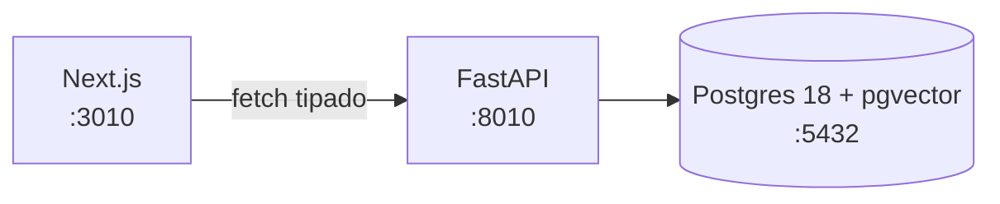

# rag-saas-demo · Asistente de una clínica dental con LangGraph

Proyecto de aprendizaje de AI engineering y MLOps. Es un asistente multi-agente de atención y agendamiento para una clínica dental ficticia, **Clínica Dental Sonrisa Clara**, que corre con modelos locales en Ollama y se construye por fases.

- **Propuesta y fases**: [PROPUESTA.md](PROPUESTA.md)
- **Decisiones técnicas**: [ADR 0001 · Stack](docs/adr/0001-stack-tecnologico.md) y [ADR 0002 · Observabilidad y versionado](docs/adr/0002-observabilidad-y-versionado.md)

## Estado actual: F0 · Cimientos

| Pieza | Estado |
|---|---|
| Backend FastAPI con `/health` y `/health/ready` | ✅ |
| Logs JSON con request_id y huella de versión | ✅ |
| Frontend Next.js que muestra el estado del backend | ✅ |
| Cliente del API tipado y generado desde OpenAPI | ✅ |
| Postgres 18 con pgvector en Docker | ✅ |
| Imágenes Docker de backend y frontend | ✅ |
| pre-commit y CI en GitHub Actions | ✅ |
| Agente LangGraph | F1 |



## Requisitos

- Docker Desktop
- [uv](https://docs.astral.sh/uv/), que instala y gestiona Python 3.13
- Node 24 y [pnpm](https://pnpm.io/)
- [just](https://just.systems/)

## Puesta en marcha

```powershell
Copy-Item .env.example .env
just setup
just db
```

Después, en dos terminales:

```powershell
just backend
```

```powershell
just frontend
```

Abre http://localhost:3010. Para levantar todo en contenedores, como en producción, usa `just up`.

## Comandos

| Comando | Qué hace |
|---|---|
| `just` | Lista todos los comandos |
| `just setup` | Instala dependencias de Python y Node y los hooks de git |
| `just db` | Levanta solo Postgres |
| `just backend` | Backend con recarga automática en el puerto 8010 |
| `just frontend` | Frontend con recarga en caliente en el puerto 3010 |
| `just up` / `just down` | Stack completo en contenedores |
| `just check` | Lint, tipos y tests de backend y frontend |
| `just gen-api` | Regenera el esquema OpenAPI y los tipos del frontend |
| `just hooks` | Ejecuta todos los hooks de pre-commit |

## Estructura

```text
.
├── backend/              # FastAPI; luego también el grafo de LangGraph
│   ├── src/app/
│   │   ├── api/          # routers HTTP
│   │   ├── core/         # configuración, logging, middleware
│   │   └── scripts/      # utilidades de línea de comandos
│   ├── tests/
│   └── Dockerfile
├── frontend/             # Next.js 16, Tailwind 4, shadcn/ui
│   ├── src/
│   ├── openapi.json      # contrato del API, generado
│   └── Dockerfile
├── infra/postgres/init/  # scripts de arranque de Postgres
├── docs/adr/             # decisiones de arquitectura
├── compose.yaml
├── justfile
└── pyproject.toml        # workspace de uv y configuración de ruff, mypy y pytest
```

## Calidad

- **Backend**: ruff para lint y formato, mypy en modo estricto y pytest.
- **Frontend**: Biome para lint y formato, TypeScript estricto y Vitest.
- **Contrato**: el CI regenera `openapi.json` y los tipos del frontend, y falla si no coinciden con lo que está en el repositorio.
- **Secretos**: detect-secrets bloquea commits con credenciales nuevas.
- **Docker**: el CI construye las dos imágenes, levanta el stack y hace un smoke test.

## Notas para Windows

- **Event loop de psycopg**: el modo async de psycopg no funciona con el `ProactorEventLoop` que Python usa por defecto en Windows. `just backend` usa `--reload`, y en ese modo uvicorn usa un `SelectorEventLoop`, que sí es compatible. Los tests fuerzan el mismo loop en `backend/tests/conftest.py`. En Linux y en Docker no hace falta nada.
- **Puertos**: el proyecto usa 8010 y 3010 porque 8000 y 3000 suelen estar ocupados por otros proyectos. Se cambian en `.env`.
- **`127.0.0.1` en lugar de `localhost`**: `localhost` intenta primero IPv6 y, como Docker publica Postgres solo en IPv4, cada conexión esperaba el timeout antes de reintentar.

## Licencia

Copyright © 2026 Jhon Edward Zacipa Casas. Todos los derechos reservados. El repositorio es público como portafolio, pero no se concede licencia para usar, copiar ni distribuir el código. Los detalles están en [LICENSE](LICENSE).

## Desarrollo asistido por IA

El código se construye junto con Claude. Claude genera la estructura y el código mecánico, y las piezas clave del agente se implementan como ejercicios guiados. Cada decisión técnica queda documentada en un ADR.
